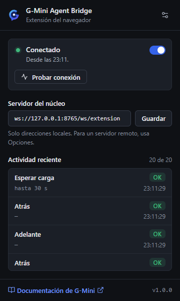
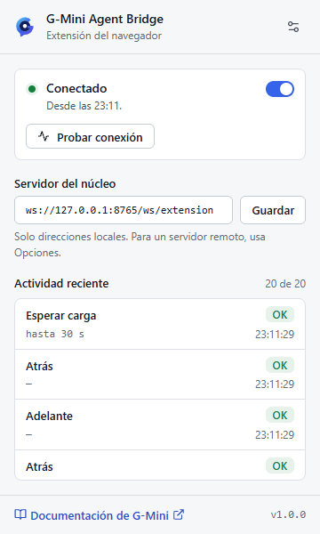

# G-Mini Agent Bridge

Browser extension that connects Chrome, Edge, Brave, Opera, Vivaldi, Firefox and
any other Chromium-based browser to [G-Mini Agent](https://github.com/angelgabrieljacintohuayllasco/G-Mini-Agent).
It lets the agent browse, read pages, fill in forms, click, take screenshots and
manage tabs in your real browser, with the sessions you are already signed in to.

[Versión en español](README.md) · [Protocol](docs/protocol.md) (Spanish) · [Security](SECURITY.md) · [Changelog](CHANGELOG.md)

<p>
  
  
</p>

## How it works

```
G-Mini Agent (core, 127.0.0.1:8765)
        │  WebSocket /ws/extension
        ▼
G-Mini Agent Bridge (extension background context)
        │  scripting / tabs / downloads
        ▼
Active browser tab
```

The core sends commands (`navigate`, `click`, `type`, `screenshot`...) and the
extension replies with the result. The protocol is the same one used by the
extension shipped in `assets/extension` of the main repository, so the core needs
no changes.

## Supported browsers

| Browser | Minimum version | Package |
|---|---|---|
| Google Chrome, Chromium | 116 | `chromium` |
| Microsoft Edge | 116 | `chromium` |
| Brave | 1.57 (Chromium 116) | `chromium` |
| Opera, Opera GX | 102 | `chromium` |
| Vivaldi | 6.2 | `chromium` |
| Arc, Yandex and other Chromium-based browsers | Chromium 116 | `chromium` |
| Firefox | 140 (ESR 140) | `firefox` |
| Safari (macOS) | 16.4 | conversion, see below |

## Installation

Download the packages from
[Releases](https://github.com/angelgabrieljacintohuayllasco/G-Mini-Agent-Extension/releases)
or build them yourself (see [Development](#development)). The Chrome Web Store is
not required.

### Chrome, Edge, Brave, Opera, Vivaldi and other Chromium browsers

1. Unzip `g-mini-agent-extension-chromium-v1.0.0.zip` into a folder you will keep.
2. Open the extensions page: `chrome://extensions`, `edge://extensions`,
   `brave://extensions`, `opera://extensions`, `vivaldi://extensions` or
   `browser://extensions` (Yandex). `chrome://extensions` works in most of them.
3. Turn on **Developer mode**.
4. Click **Load unpacked** and select the folder that contains `manifest.json`.
5. Pin the icon to see the connection status at a glance.

### Firefox

- **Temporary:** open `about:debugging#/runtime/this-firefox`, click **Load
  Temporary Add-on...** and pick the Firefox zip. It is removed when Firefox
  closes.
- **Permanent:** release Firefox only installs add-ons signed by Mozilla. Sign it
  as an unlisted add-on on [addons.mozilla.org](https://addons.mozilla.org/developers/)
  (or `npx web-ext sign --channel=unlisted`), or use Developer Edition, Nightly
  or ESR with `xpinstall.signatures.required` set to `false` and install the zip
  renamed to `.xpi`.

Firefox asks for access to all websites on install. If you decline, grant it
later in `about:addons` > G-Mini Agent Bridge > Permissions.

### Safari (macOS)

```sh
xcrun safari-web-extension-converter dist/chromium \
  --app-name "G-Mini Agent Bridge" \
  --bundle-identifier com.gmini.agent.bridge \
  --macos-only --copy-resources --no-open --project-location safari
```

Build and run the Xcode project it creates, enable "Allow unsigned extensions" in
Safari's Develop menu and turn the extension on in Settings > Extensions. Safari
has no downloads API, so `downloads_list` returns an error.

## Using it with G-Mini Agent

1. Start G-Mini Agent. The core listens on `127.0.0.1:8765`.
2. The extension connects within a few seconds; the toolbar icon shows an **ON**
   badge while G-Mini controls the browser.
3. Every action the agent runs appears in the popup with its result.

Popup states: **Conectado** (connected), **Reconectando** (retrying with backoff
up to 30 s), **Sin app** (G-Mini Agent is not running), **Error** (another
browser took the connection, or the server address is not allowed) and **En
pausa** (paused by you). The options page lets you pause the connection, change
the port or full server address, allow remote servers (with an explicit
confirmation), clear the activity log and reset to defaults.

## Permissions

| Permission | Why |
|---|---|
| `tabs` | Read tab URLs and titles; list, switch, open and close tabs |
| `scripting` | Inject the content script into the tab the agent operates |
| `<all_urls>` (host) | Operate and capture any site the agent opens |
| `downloads` | `downloads_list` |
| `storage` | Settings and session activity log |
| `alarms` | Wake the service worker up to reconnect |

## Security and privacy

- Connects only to `127.0.0.1`, `localhost` or `[::1]` by default; remote servers
  must be enabled in the options page and confirmed.
- Only the 24 protocol commands are accepted, and their parameters are validated
  before touching the browser.
- The `eval` command runs the script in the page's main world, with the page's
  privileges and none of the extension's. It is the only place that turns text
  into code; if the page's CSP forbids it, the error says so and suggests
  `browser_extract` or `browser_snapshot`.
- No telemetry. Page data goes only to the G-Mini Agent core you configure, which
  may forward it to the model provider you set up there.
- The activity log lives in session memory only and never contains typed text or
  script contents.

See [SECURITY.md](SECURITY.md) for details and how to report a vulnerability.

## Development

Requires Node.js 22.12 or later.

```sh
npm ci
npm run build       # dist/chromium, dist/firefox and both zips
npm run check:dist  # validates manifests and zips
npm run lint
npm test            # unit tests (node --test)
CHROME_PATH=/path/to/chrome npm run test:e2e
CHROME_PATH=/path/to/chrome GMINI_CORE_DIR=/path/to/G-Mini-Agent npm run test:e2e -- --core=real
```

Stable Chrome 137+ ignores `--load-extension`; use Chrome for Testing, Chromium,
Edge or Brave for the end-to-end test. See [CONTRIBUTING.md](CONTRIBUTING.md).

## License

[MIT](LICENSE)
