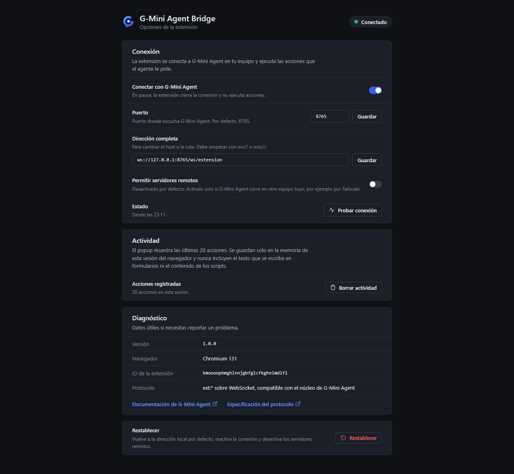

# G-Mini Agent Bridge

Extensión de navegador que conecta Chrome, Edge, Brave, Opera, Vivaldi, Firefox y
cualquier otro navegador basado en Chromium con [G-Mini Agent](https://github.com/angelgabrieljacintohuayllasco/G-Mini-Agent).
Con ella, el agente puede navegar, leer páginas, rellenar formularios, hacer clic,
tomar capturas y manejar pestañas en tu navegador real, con tus sesiones ya
iniciadas.

[English version](README.en.md) · [Protocolo](docs/protocol.md) · [Seguridad](SECURITY.md) · [Cambios](CHANGELOG.md)

<p>
  
  
</p>

## Cómo funciona

```
G-Mini Agent (núcleo, 127.0.0.1:8765)
        │  WebSocket /ws/extension
        ▼
G-Mini Agent Bridge (contexto de fondo de la extensión)
        │  scripting / tabs / downloads
        ▼
Pestaña activa del navegador
```

El núcleo envía comandos (`navigate`, `click`, `type`, `screenshot`...) y la
extensión responde con el resultado. El protocolo es el mismo que el de la
extensión incluida en `assets/extension` del repositorio principal, así que el
núcleo no necesita cambios. El detalle está en [docs/protocol.md](docs/protocol.md).

## Navegadores compatibles

| Navegador | Versión mínima | Paquete |
|---|---|---|
| Google Chrome, Chromium | 116 | `chromium` |
| Microsoft Edge | 116 | `chromium` |
| Brave | 1.57 (Chromium 116) | `chromium` |
| Opera, Opera GX | 102 | `chromium` |
| Vivaldi | 6.2 | `chromium` |
| Arc, Yandex y otros basados en Chromium | Chromium 116 | `chromium` |
| Firefox | 140 (ESR 140) | `firefox` |
| Safari (macOS) | 16.4 | conversión, ver abajo |

## Instalación

Descarga los paquetes de la página de
[Releases](https://github.com/angelgabrieljacintohuayllasco/G-Mini-Agent-Extension/releases)
o genéralos tú (ver [Desarrollo](#desarrollo)):

- `g-mini-agent-extension-chromium-v1.0.0.zip`
- `g-mini-agent-extension-firefox-v1.0.0.zip`

No hace falta la Chrome Web Store.

### Chrome, Edge, Brave, Opera, Vivaldi y demás Chromium

1. Descomprime `g-mini-agent-extension-chromium-v1.0.0.zip` en una carpeta que
   no vayas a borrar (por ejemplo `Documentos\G-Mini Agent Bridge`).
2. Abre la página de extensiones de tu navegador:

   | Navegador | Dirección |
   |---|---|
   | Chrome, Chromium, Arc | `chrome://extensions` |
   | Edge | `edge://extensions` |
   | Brave | `brave://extensions` |
   | Opera, Opera GX | `opera://extensions` |
   | Vivaldi | `vivaldi://extensions` |
   | Yandex | `browser://extensions` |

   En casi todos también funciona `chrome://extensions`.
3. Activa el **Modo de desarrollador** (interruptor arriba a la derecha; en Edge,
   en el panel izquierdo).
4. Pulsa **Cargar descomprimida** (Edge: "Cargar desempaquetada") y elige la
   carpeta del paso 1, la que contiene `manifest.json`.
5. Fija el icono en la barra de herramientas para ver el estado de un vistazo.

Para actualizar, reemplaza el contenido de la carpeta y pulsa el botón de recargar
de la extensión. Algunos navegadores muestran al iniciar un aviso sobre
extensiones en modo de desarrollador: es normal para extensiones que no vienen de
una tienda.

### Firefox

**Temporal (para probar):**

1. Abre `about:debugging#/runtime/this-firefox`.
2. Pulsa **Cargar complemento temporal...** y elige el zip de Firefox (o el
   `manifest.json` de la carpeta descomprimida).
3. Firefox la quita al cerrarse.

**Permanente:** Firefox estable solo instala complementos firmados por Mozilla.
Opciones:

- Firmarla como complemento no listado en [addons.mozilla.org](https://addons.mozilla.org/developers/)
  (o con `npx web-ext sign --channel=unlisted`) e instalar el `.xpi` firmado. La
  validación automática avisará de `DANGEROUS_EVAL` por el comando `eval` (ver
  [Seguridad](#seguridad)).
- En Firefox Developer Edition, Nightly o ESR, poner
  `xpinstall.signatures.required` en `false` en `about:config` e instalar el zip
  renombrado a `.xpi`.

Firefox pide al instalar el permiso para acceder a todos los sitios. Si lo
rechazas, actívalo después en `about:addons` > G-Mini Agent Bridge > Permisos.

### Safari (macOS)

Safari no carga extensiones de Chrome directamente, pero Xcode las convierte sin
cambios de código:

```sh
xcrun safari-web-extension-converter dist/chromium \
  --app-name "G-Mini Agent Bridge" \
  --bundle-identifier com.gmini.agent.bridge \
  --macos-only --copy-resources --no-open --project-location safari
```

1. Abre el proyecto generado en `safari/` con Xcode y ejecútalo (Product > Run).
2. En Safari: Ajustes > Avanzado > "Mostrar funciones para desarrolladores web";
   luego Desarrollo > "Permitir extensiones sin firmar".
3. Activa la extensión en Ajustes > Extensiones y dale acceso a todos los sitios.

Limitación: Safari no tiene API de descargas, así que `downloads_list` responde
con error.

## Uso con G-Mini Agent

1. Abre G-Mini Agent. El núcleo escucha en `127.0.0.1:8765`.
2. La extensión se conecta sola en unos segundos y el icono muestra la insignia
   **ON** mientras G-Mini tiene el control del navegador.
3. Pide al agente algo que use el navegador ("abre mi correo y resume lo
   pendiente"). Cada acción aparece en el popup con su resultado.

Los avisos de instalación del núcleo hablan de la carpeta `assets/extension`: con
este proyecto, carga `dist/chromium` (o el zip descomprimido) en su lugar.

### Popup

| Estado | Significado |
|---|---|
| Conectado | G-Mini Agent puede operar el navegador |
| Reconectando | Se perdió la conexión y la extensión reintenta (1, 2, 4... hasta 30 s) |
| Sin app | Varios intentos sin respuesta: G-Mini Agent no está abierto |
| Error | Algo requiere atención: otro navegador tomó la conexión o la dirección no es válida |
| En pausa | Desactivaste la conexión con el interruptor |

También tiene **Probar conexión**, la dirección del servidor y las últimas 20
acciones (hora, acción, objetivo, OK o error).

### Opciones

Clic derecho en el icono > Opciones (o el botón de ajustes del popup):

- Pausar o reanudar la conexión.
- Cambiar el puerto o la dirección completa del núcleo.
- Permitir servidores remotos (requiere confirmación explícita).
- Borrar la actividad, ver datos de diagnóstico y restablecer los valores
  predeterminados.



## Permisos

| Permiso | Para qué |
|---|---|
| `tabs` | Leer URL y título de las pestañas, listarlas, cambiarlas, abrirlas y cerrarlas |
| `scripting` | Inyectar el content script en la pestaña que el agente opera |
| `<all_urls>` (host) | Operar y capturar cualquier sitio que el agente abra |
| `downloads` | `downloads_list`: consultar las descargas recientes |
| `storage` | Guardar los ajustes y la actividad de la sesión |
| `alarms` | Despertar el service worker para reconectar |

Respecto de la extensión anterior se quitaron `cookies`, `webNavigation` y
`activeTab`, que no se usaban, y los recursos accesibles desde la web.

## Seguridad

- Por defecto solo se conecta a `127.0.0.1`, `localhost` o `[::1]`. Un servidor
  remoto exige activarlo en Opciones y confirmar un aviso.
- Solo ejecuta los 24 comandos del protocolo; cualquier otro recibe `Unknown
  command` y los parámetros se validan antes de tocar el navegador.
- El comando `eval` (acción `browser_eval`) usa el mismo mecanismo que la
  extensión anterior, aislado en un único archivo. Chromium lo bloquea en Manifest
  V3 (ver [docs/protocol.md](docs/protocol.md#31-eval)).
- Las páginas de la extensión tienen una CSP estricta (`script-src 'self'`) y la
  interfaz nunca inserta HTML.
- El content script solo se inyecta en la pestaña que el agente opera, cuando lo
  necesita.

Más detalle y cómo reportar vulnerabilidades: [SECURITY.md](SECURITY.md).

## Privacidad

- La extensión no tiene telemetría ni se comunica con ningún servidor salvo el
  núcleo de G-Mini Agent que configures (por defecto, en tu propio equipo).
- Lo que el agente lee del navegador (texto, URL, capturas) va al núcleo de G-Mini
  Agent, que puede enviarlo al proveedor de modelos que tengas configurado. Eso se
  controla desde G-Mini Agent.
- La actividad del popup se guarda solo en memoria de la sesión
  (`storage.session`) y se borra al cerrar el navegador. Nunca incluye el texto que
  se escribe en formularios ni el contenido de los scripts, y las URL se muestran
  sin parámetros.
- Firefox muestra al instalar que la extensión transmite actividad de navegación
  y contenido de sitios web: es lo que recibe el núcleo de G-Mini Agent.

## Solución de problemas

| Síntoma | Qué hacer |
|---|---|
| "Sin app" | Abre G-Mini Agent. Si usa otro puerto, cámbialo en Opciones. |
| "Error: otro navegador o perfil tomó la conexión" | El núcleo acepta una sola extensión. Pulsa **Conectar aquí** en el navegador que quieras usar. |
| "Probar conexión" dice que el núcleo rechazó la conexión | Comprueba que la ruta sea `/ws/extension` y que G-Mini Agent esté actualizado. |
| `Cannot access this page` | Los navegadores no dejan operar páginas internas (`chrome://`, `edge://`, `about:`, tiendas de extensiones). Navega a un sitio normal. |
| `browser_eval` falla con `Eval error: Refused to evaluate...` | Limitación de Manifest V3 en Chromium (ver [protocolo](docs/protocol.md#31-eval)). |
| Firefox: no opera ningún sitio | Concede el acceso a todos los sitios en `about:addons` > Permisos. |
| Se desconecta al minimizar o tras un rato | La alarma de vigilancia reconecta en menos de 30 s. Si persiste, revisa que el antivirus o un firewall no bloquee `127.0.0.1:8765`. |
| Quiero ver los registros | `chrome://extensions` > G-Mini Agent Bridge > "service worker" abre la consola del fondo. |

## Desarrollo

Requisitos: Node.js 22.12 o superior.

```sh
npm ci
npm run build       # dist/chromium, dist/firefox y los dos zips
npm run check:dist  # valida manifiestos y zips
npm run lint
npm test            # pruebas unitarias (node --test)
```

Prueba de extremo a extremo con un Chromium sin interfaz. Chrome estable 137+ ya
no admite `--load-extension`: usa [Chrome for Testing](https://googlechromelabs.github.io/chrome-for-testing/),
Chromium, Edge o Brave.

```sh
CHROME_PATH=/ruta/a/chrome npm run test:e2e
# Contra un núcleo real de G-Mini Agent (en un puerto libre y con datos temporales):
CHROME_PATH=/ruta/a/chrome GMINI_CORE_DIR=/ruta/a/G-Mini-Agent npm run test:e2e -- --core=real
```

Estructura:

```
src/
  background/   conexión, enrutador de comandos y comandos del navegador
  content/      acciones DOM que se inyectan en la página
  popup/        popup de la barra de herramientas
  options/      página de opciones
  shared/       protocolo, ajustes, estado y utilidades comunes
  ui/           tokens de diseño y componentes CSS
  manifest.base.json
scripts/        build, generación de manifiestos, zips e iconos
tests/unit/     pruebas unitarias
tests/e2e/      prueba de humo con Puppeteer y núcleos simulado y real
assets/brand/   marca en SVG (fuente de los iconos PNG)
```

Guía completa en [CONTRIBUTING.md](CONTRIBUTING.md).

## Licencia

[MIT](LICENSE)
